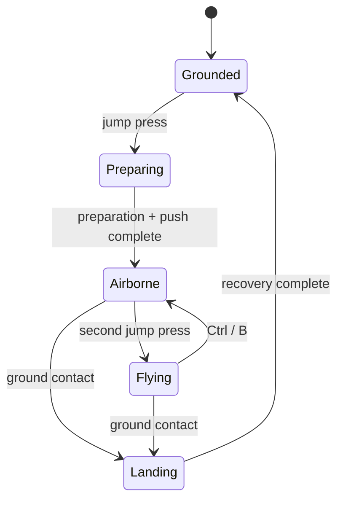

# Camera gaze, jumping and demo flight

The changes are in the Godot playground. They retain Clay's modeled anatomy,
skinning and authored wing-fold shapes. Timings and limits live in
`game/data/locomotion.json`; the model build exports measured neck sections to
the ignored `game/assets/clay_rig.json` alongside the other runtime anatomy.

## Camera-guided neck and head

The source has four measured neck rig sections, not a declared count of individual
cervical vertebrae. Runtime uses those four bones plus `head`. The neck receives
70% of the turn, weighted by segment length; the head receives 30%. Local joint
attachments and bone lengths stay fixed. Poses are evaluated from rest each frame
to avoid accumulated rotation drift.

Yaw is camera heading relative to the character's heading, clamped to ±90°.
Ground gaze pitch is camera elevation relative to the original -0.4-radian ground
camera framing, clamped to ±20°. This makes the default rear view an authored
neutral gaze. In flight, the head compensates for actual body pitch instead.

Front stage engages beyond 92° from the rear view and disengages below 90.5°.
It requests the original rest pose, rather than following the camera around the
front. Both gaze tracking and neutral return use damping and a 120°/second
angular speed cap. Crossing the ±180° camera wrap stays in front stage, so the
head cannot flip across the body. The small hysteresis prevents boundary chatter.

## Jump sequence

The controller plays 0.04 s of preparation and 0.08 s of push-off before applying
a 13.5 m/s upward impulse. At 24 m/s² gravity, the discrete controller reaches
about 3.9 m above takeoff, compared with roughly 1.8 m previously. Descent uses
36 m/s² gravity for a more decisive fall; ascent retains 24 m/s² and its existing
height. Powered flight uses its separate controller. The visual
body compresses, then lifts the chest around the hips, with forepaw release at
0.045 s and hind-paw push continuing until liftoff. Running takeoffs gather the
paws and plant briefly beneath the moving torso instead of retaining stale
gallop contacts throughout preparation.

In the air, forelimbs tuck first and hind recovery follows 0.10 s later. Body
pitch follows vertical velocity from 16° nose-up to level at the apex and up to
12° nose-down on descent. Forepaws extend toward landing before the hind paws.
Landing compression lasts 0.22 s at rest or 0.10 s while moving, then hands back
to the ground gait. Pose rotation is centered at the hips so chest lift does not
pull the supporting hindquarters away from the ground.

Canine obstacle-jump measurements distinguish limb support and propulsion during
takeoff. The staged pose uses that sequence as an animation reference. More
height comes from the increased launch impulse, not from rotating the body in
midair; forward momentum produces the running jump's arc.
[Effect of bar jump height on takeoff kinetics and kinematics](https://pmc.ncbi.nlm.nih.gov/articles/PMC11761639/).

Feline jump work distinguishes preparatory coordination from propulsive muscle
activity. These phases motivate a separate preparation and push rather than
using a walking swing pose for jumping. Clay's timings and amplitudes are
animation choices, not copied measurements from cats.
[Zajac, thigh activity during maximum-height jumps](https://pubmed.ncbi.nlm.nih.gov/3998801/).

Landing research measures coordinated elbow, wrist, knee and ankle behavior.
The demo uses coordinated proximal IK and separate distal roll, with an earlier
forelimb contact and subsequent hindlimb settling. It does not model individual
muscle forces, impact energy or independent phalangeal flexion.
[Limb-joint energy absorption during landing](https://pmc.ncbi.nlm.nih.gov/articles/PMC6721424/).

A fast second press during preparation is queued and consumed at takeoff. A held
button never becomes a second press. Reset clears the queue and all flight state.

## Flight convention and wing cycle

The camera's actual elevation determines the commanded flight path. Above the
2.5° horizon deadzone, the character climbs and flaps. At the horizon or below,
the character glides. C/right-stick click levels the camera during flight.
Forward cruise does not require held input; WASD/left stick changes camera-relative
heading. Shift/LB raises cruise speed. Descent into terrain returns through the
landing animation; Ctrl/B explicitly leaves flight and resumes gravity.

Climbing uses a steady 0.8 Hz cycle, with a 55% power stroke and a 45% recovery.
The shoulder and its two existing tissue helpers share the stroke, while a small
authored fold during recovery coordinates the elbow, wrist and fan. Glide returns
to the extended span with a small dihedral. Flap weight, deployment, body pitch,
bank and carried limbs ease between states. The subsequent
[flight-limb and tail pass](clay-flight-limbs-tail.md) adds distinct forelimb and
hindlimb carriage from the indexed artwork. Low-ground clearance suppresses large
downstrokes near takeoff/landing. The tail samples the aerial root trail in 3D,
preserving its segment lengths.

Bat kinematics show that wing shape and span change over the wingbeat and with
flight speed. This motivates a different recovery shape instead of sweeping a
fully rigid wing. The large dragon's slow frequency and amplitude are design
choices; no bat-to-dragon scaling claim is made.
[Wing shape across flight speed](https://pmc.ncbi.nlm.nih.gov/articles/PMC3522884/).

## Verification and limits

`gaze_flight_smoke.gd` exercises the actual player and rig: tracking limits, real
head orientation, front-stage return and camera wrap, per-tick continuity,
neck attachments, staged jumping/landing, held versus repeated jump input,
wing deployment, climb, level/descending glide, cancellation and reset. Existing
movement, stance/tail and source-wing-sampler checks remain separate regressions.
`render_gaze_flight_review.gd` renders review PNGs in the ignored cache folder.

The flight controller is deliberately playable: it targets velocities and holds
altitude in level glide. There is no aerodynamic lift/drag, stall, dynamic balance
or muscle-force simulation. The capsule remains a simple controller collider;
wing and tail surfaces do not collide with props. Extreme neck bends and flight
shoulder deformation still use the current skin weights and need visual review.

Descent-gravity verification (2026-10-31): the default wetlands scene retains a
3.91 m rise and 0.567 s ascent; descent takes 0.467 s instead of 0.567 s. Free
fall has no terminal-speed cap or aerodynamic drag; powered-flight limits are
separate. The jump-arc smoke check still reports a 0.393 m standing takeoff paw
support error. A control run using the original 24 m/s² descent reproduces the
same error, so it is a pre-existing takeoff issue, not introduced by heavier
falling gravity. Running takeoff support passes.

## Continental travel tuning

Flight cruise is now 60 m/s and Shift / LB boost is 180 m/s. Horizontal acceleration
is 12 m/s² normally and 18 m/s² boosted; releasing boost sheds speed at 10 m/s².
The climb limit is 45 m/s normally and 110 m/s boosted, with vertical acceleration
of 16 / 30 m/s². The flight camera allows 65° upward aim; ordinary ground look
retains its existing limit. These are authored travel controls, not aerodynamics.
The village boundary has tall side walls and an open sky instead of its old
180 m collision ceiling. Continent terrain has no overhead cap.

`game/tests/flight_travel_smoke.gd` checks gradual speed buildup, smooth coasting,
steep camera aim, sustained ascent beyond the highest generated peak and the
actual village boundary collider.
